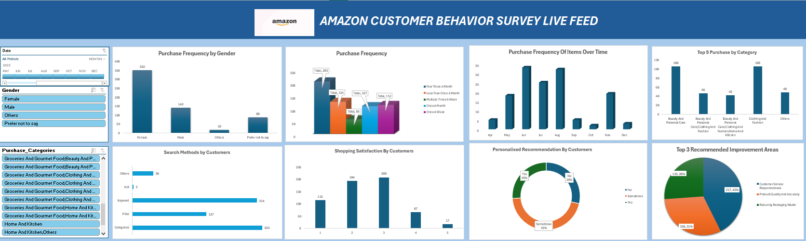
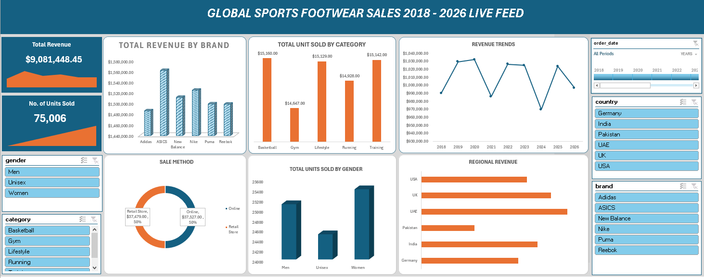
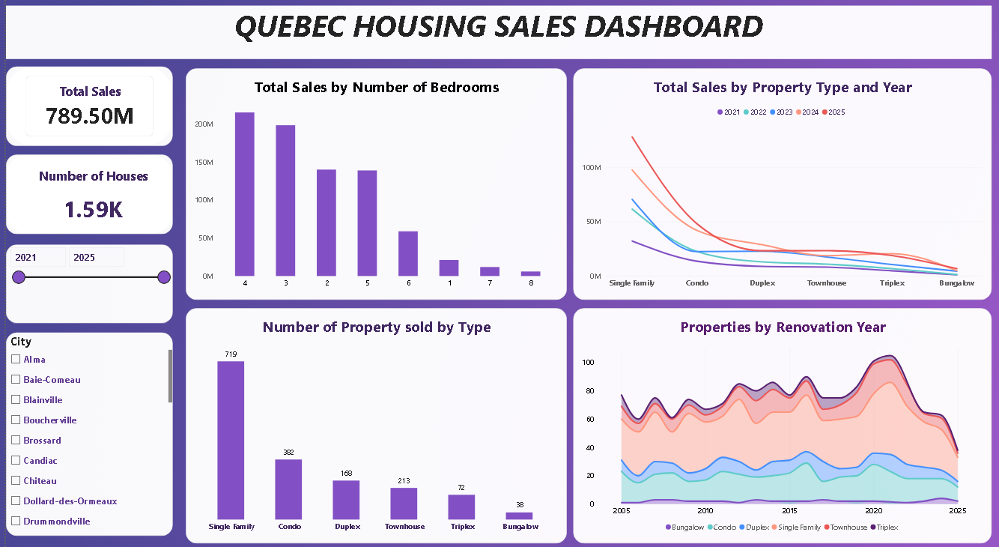
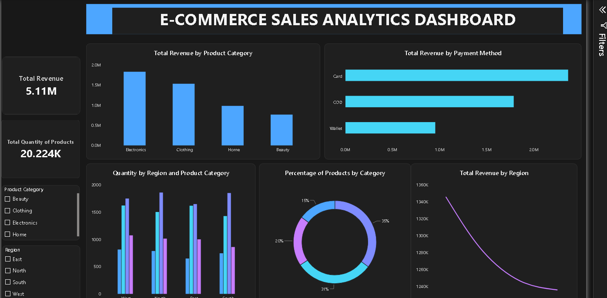

# Data Analytics Project Portfolio

# Project 1
**Title:** Amazon Customer Behavior Survey

**Tools Used:** (Microsoft Excel, Conditional Formatting, Pivot Table, Pivot Charts, Timelines, Power Query Editor)

**Project Description:** This project analyses Amazon customers’ purchasing behaviour in 2023. It highlights key sales trends and provides insights into buying patterns across products and time periods. The dashboard presents important performance indicators in a clear visual format, enabling stakeholders to identify the most frequently purchased products, compare product performance, monitor purchasing trends over time, and support informed business decisions. The dashboard includes the following features:

Top Five Product Categories by Purchase Volume: This visual highlights the five product categories most frequently purchased by customers, offering clear insight into the strongest-performing categories within the dataset.

Purchase Frequency by Gender: This visual compares purchase frequency across gender groups, showing their relative contribution to overall purchasing activity and providing insight into the customer composition represented in the dataset.

Purchase Frequency of Items Over Time: This visual presents monthly purchase frequency, enabling clear comparison of purchasing activity and the identification of trends and fluctuations throughout the year.

Recommendation Helpfulness: This visual summarises customers’ responses regarding the usefulness of recommendations from previous buyers, providing insight into the extent to which these recommendations influenced their purchasing decisions.

Search Methods by Customers: This visual summarises the methods customers use to discover products, offering insight into their preferred search channels and how they navigate the platform before making a purchase.

Customer Shopping Satisfaction: This visual summarises customers’ reported satisfaction with their shopping experience, providing insight into overall sentiment and the distribution of satisfaction levels within the dataset.

Top Three Improvement Areas: This visual highlights the three areas most frequently identified by customers for improvement, helping to prioritise service enhancements and guide initiatives aimed at improving the overall shopping experience.

Additionally, the dashboard includes interactive slicers and a timeline for:

Month: Filter the data to view monthly purchase activities.

Gender: Focus on specific gender groups to analyze their purchasing contributions to the overall purchasing activities.

Product Category: Drill down into the performance of individual categories of products.

 
**Key findings:**

Leading Product Categories: The dashboard identifies the five product categories purchased most frequently, highlighting the categories with the strongest customer demand.

Gender-Based Purchasing: Purchase frequency varies across gender groups, revealing how each group contributes to overall purchasing activity.

Monthly Purchasing Trends: Purchasing activity fluctuates throughout the year, indicating periods of stronger and weaker customer demand.

Product Discovery: Customers use several search methods to find products, showing the channels that play the greatest role in product discovery.

Recommendations and Satisfaction: Customer responses show how helpful previous buyers’ recommendations are and provide insight into overall shopping satisfaction.

Priority Improvement Areas: The three most frequently recommended improvements indicate where service enhancements should be prioritised to strengthen the customer shopping experience.

This dashboard serves as a crucial tool for Amazon’s management team, providing clear, actionable insights that drive informed decision-making and strategic planning.

**Dashboard Overview**

[Amazon Customer Behavior Survey Dashboard.xlsx]

# Project 2

**Title:** Global Sports Footwear Sales

**Tools Used:** (Microsoft Excel, Conditional Formatting, Pivot Table, Pivot Charts, Timelines, Power Query Editor)

**Project Description:** This project analyses footwear sales performance from 2018 to 2026. The dashboard provides a clear overview of revenue, units sold, customer segments, and sales trends. Stakeholders can compare performance by brand, country, product category, gender, and time period to support informed business decisions. The dashboard includes the following features:
 
Total Revenue by Brand: A visual representation of revenue generated across brands. It helps stakeholders compare the revenue earned by each footwear brand.

Total Revenue per Year: A yearly breakdown of total revenue generated, showing annual revenue and changes in sales over time.

Sales Method: Shows performance across channels, compares sales channels, and indicates how customers prefer to buy products.

Total Units Sold by Gender: This visual shows the number of products sold to each gender group. 

Total Revenue by Country: Compares revenue across countries and markets.

Additionally, the dashboard includes interactive slicers and a timeline for:

Years: Filter the data to view results for a selected year or date range.

Gender: Compare sales across gender groups.

Country: Focus on specific countries to review performance in a selected country.

Brands: Review the performance of a specific footwear brand.

Category: Compare results across footwear categories.

**Key findings:** 

Regional Performance: The dashboard shows the countries with the highest revenue and the markets that need improvement.

Sales Trends: Sales change over time. These patterns can support better planning for stock and marketing.

Top Brands and Categories: The dashboard identifies the brands and categories that generate the most revenue and sales.

Changes in Sales: Differences between reporting periods help users understand market changes and identify areas for further review.

This dashboard gives management a clear view of footwear sales performance. It helps users track results, find growth opportunities, and make better decisions about stock, marketing, and business planning.

**Dashboard Overview:**

# Project 3
**Title:**

**SQL Code:**

**SQL Skills Used:**

**Project Description:**

**Technology used:** SQL server

Data Retrieval (SELECT): Queried and extracted specific information from the database.
Data Aggregation (SUM, COUNT): Calculated totals, such as sales and quantities, and counted records to analyze data trends.
Data Filtering (WHERE, BETWEEN, IN, AND): Applied filters to select relevant data, including filtering by ranges and lists.
Data Source Specification (FROM): Specified the tables used as data sources for retrieval

# Project 4

**Title:** Quebec Housing Sales (2021-2025)

**Tools Used:** (Microsoft Power BI, Power Query Editor, M Code, DAX, Power BI Desktop Canvas, Power BI Services)

**Project Description:** This project analyses house sales in Quebec from 2021 to 2025. The dashboard provides a clear overview of sales performance, the number and types of properties sold, and renovation trends. Stakeholders can compare results by property type, number of bedrooms, city, and time period to support informed decision-making.
 
Total Sales by Number of Bedrooms: A visual representation of total sales based on the number of bedrooms within the property. It helps stakeholders compare the sales made by each property based on the number of bedrooms it has.

Total Sales by Number of Bedrooms: Compares total sales across properties with different numbers of bedrooms.

Total Sales by Property Type and Year: Shows annual sales for each property type and highlights changes over time.

Number of Properties Sold by Type: Displays the number of properties sold within each property category.

Properties by Renovation Year: Groups properties by renovation period to show the age and renovation profile of the homes sold.

Additionally, the dashboard includes interactive slicers and a timeline for:

Year and Timeline: Filter the dashboard by a specific year or date range.

City: Compare property sales across cities in Quebec.

**Key findings:** 

Sales by Bedroom Count: Properties with more bedrooms generally generated higher total sales, with five-bedroom homes recording the highest value.

Sales Trend: Total sales increased overall during the period, although performance varied from year to year.

Property Types: Bungalows accounted for the largest share of properties sold, followed by two-storey homes.

Renovation Profile: Most properties were renovated between 1981 and 2000, while fewer properties were renovated in the most recent period.

Overall, the dashboard gives stakeholders a simple view of Quebec’s housing market. It supports comparisons across property types, bedroom counts, cities, and years, helping users identify sales patterns and make informed planning decisions.

**Dashboard Overview:**

# Project 5

**Title:**E-Commerce Analytics

**Tools Used:** (Microsoft Power BI, Power Query Editor, M Code, DAX, Power BI Desktop Canvas, Power BI Services)

**Project Description:** This project analyses footwear sales performance from 2018 to 2026. The dashboard provides a clear overview of revenue, units sold, customer segments, and sales trends. Stakeholders can compare performance by brand, country, product category, gender, and time period to support informed business decisions. The dashboard includes the following features:
 
Total Revenue by Brand: A visual representation of revenue generated across brands. It helps stakeholders compare the revenue earned by each footwear brand.

Total Revenue per Year: A yearly breakdown of total revenue generated, showing annual revenue and changes in sales over time.

Sales Method: Shows performance across channels, compares sales channels, and indicates how customers prefer to buy products.

Total Units Sold by Gender: This visual shows the number of products sold to each gender group. 

Total Revenue by Country: Compares revenue across countries and markets.

Additionally, the dashboard includes interactive slicers and a timeline for:

Years: Filter the data to view results for a selected year or date range.

Gender: Compare sales across gender groups.

Country: Focus on specific countries to review performance in a selected country.

Brands: Review the performance of a specific footwear brand.

Category: Compare results across footwear categories.

**Key findings:** 

Regional Performance: The dashboard shows the countries with the highest revenue and the markets that need improvement.

Sales Trends: Sales change over time. These patterns can support better planning for stock and marketing.

Top Brands and Categories: The dashboard identifies the brands and categories that generate the most revenue and sales.

Changes in Sales: Differences between reporting periods help users understand market changes and identify areas for further review.

This dashboard gives management a clear view of footwear sales performance. It helps users track results, find growth opportunities, and make better decisions about stock, marketing, and business planning.

**Dashboard Overview:**

